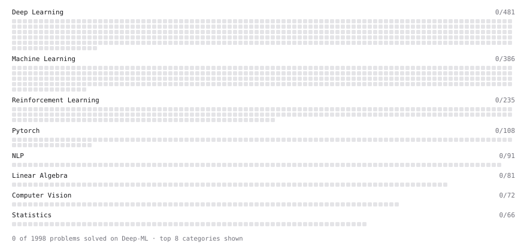

# Deep-ML

My machine learning practice from [Deep-ML](https://www.deep-ml.com). Every solution here was written by hand.

**2** solved · 0 problems · 0 labs · 2 math

[**Browse the interactive portfolio**](https://jaken31.github.io/deep-ml/) to replay this filling in over time.

## Math

| | Difficulty | Solved | |
| --- | --- | --- | --- |
| [Bytes in the KV Cache (MHA, GQA, MQA, MLA)](https://www.deep-ml.com/math-problems/62) | easy | 2026-11-10 | [solution](math/0062-bytes-in-the-kv-cache-mha-gqa-mqa-mla) |
| [Softmax and Cross-Entropy](https://www.deep-ml.com/math-problems/32) | medium | 2026-11-05 | [solution](math/0032-softmax-and-cross-entropy) |

---

_This file is regenerated by Deep-ML on every push._
